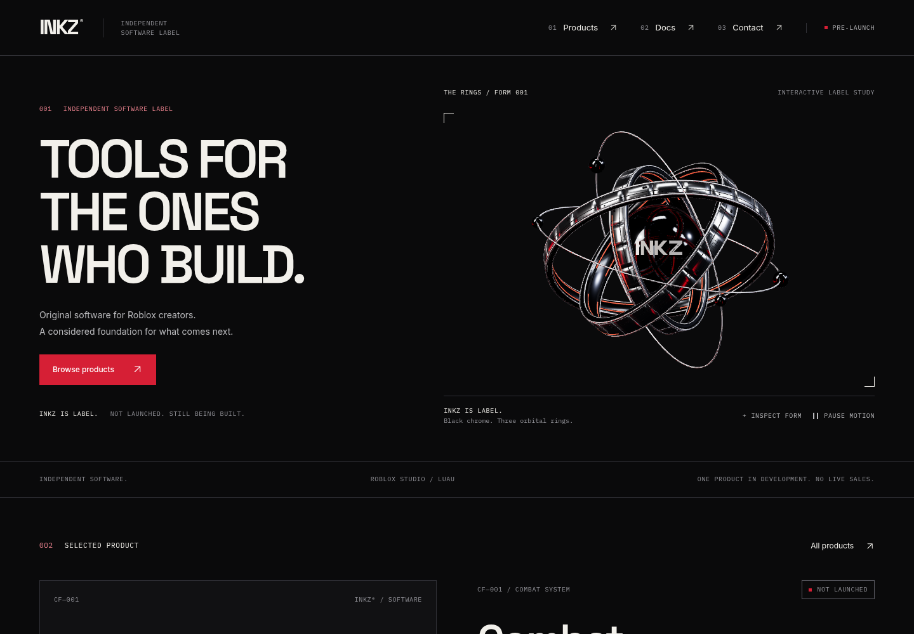
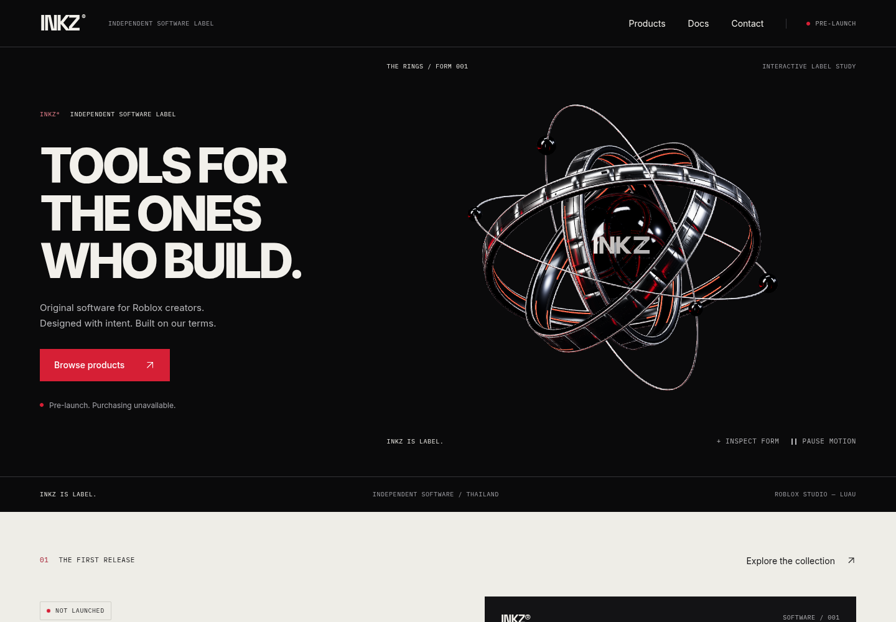

# INKZ — full layout rework

17 October 2026 · Asia/Bangkok. Actual local production-build renders of application commit `826771a`, captured with Chromium and software WebGL. These are screenshots of the working site, not mockups, concept art, or deployed-browser captures. Owner visual approval is still pending.

The layout now gives the approved sculpture a larger dark stage, pairs it with a paper product presentation, and carries a consistent editorial hierarchy through the catalog, product record, documentation, support, policies and checkout states. Original flat typographic product artwork replaces the simulated software box; it is explicitly labeled as artwork, never product footage. Navigation is simpler and sticky, documentation has one contents rail, and phone layouts use readable stacked sections.

The approved GLB, reflection probes, source assets, poster, Three.js renderer and interaction controller are unchanged. Only their surrounding layout and responsive stage dimensions changed. The product title uses no unverified registration mark; the confirmed INKZ® brand is retained. A real tablet render exposed cropped outer orbits; the stage now maintains sufficient width relative to its height. `src/lib/**`, API routes, business/product configuration and `paymentsEnabled: false` match the merged baseline. No purchases, downloads or live payments were enabled.

## Before and after

Both captures use a 1440 × 1000 browser viewport. The sculpture is the same approved asset; its presentation changes with the layout.

| Previous layout | New layout |
| --- | --- |
|  |  |

[Full desktop homepage](./desktop-home.png) · [Full phone homepage](./mobile-home.png) · [Actual browser motion recording](./motion-review.mp4) · [Inspect view](./rings-inspected.png)

## Every public page

| Route | Desktop · 1440 px | Phone · 390 px |
| --- | --- | --- |
| `/` | [Homepage](./desktop-home.png) | [Homepage](./mobile-home.png) |
| `/products` | [Collection](./desktop-products.png) | [Collection](./mobile-products.png) |
| `/products/combat-framework` | [Product record](./desktop-product.png) | [Product record](./mobile-product.png) |
| `/docs` | [Starter guide](./desktop-docs.png) | [Starter guide](./mobile-docs.png) |
| `/contact` | [Contact & support](./desktop-contact.png) | [Contact & support](./mobile-contact.png) |
| `/terms` | [Terms & licensing](./desktop-terms.png) | [Terms & licensing](./mobile-terms.png) |
| `/refund-policy` | [Refund policy](./desktop-refunds.png) | [Refund policy](./mobile-refunds.png) |
| `/privacy` | [Privacy policy](./desktop-privacy.png) | [Privacy policy](./mobile-privacy.png) |
| `/sandbox/checkout` | [Closed Sandbox](./desktop-sandbox.png) | [Closed Sandbox](./mobile-sandbox.png) |
| `/sandbox/checkout/success` | [Informational return](./desktop-success.png) | [Informational return](./mobile-success.png) |
| `/sandbox/checkout/cancel` | [Cancellation return](./desktop-cancel.png) | [Cancellation return](./mobile-cancel.png) |
| Unknown route | [Real HTTP 404](./desktop-404.png) | [Real HTTP 404](./mobile-404.png) |

Additional actual states: [desktop empty search](./desktop-empty.png), [phone empty search](./mobile-empty.png), [mobile menu](./mobile-menu.png), [unavailable WebGL/model](./model-unavailable.png), [reduced-motion phone](./mobile-reduced-motion.png). The shared error boundary and scoped Sandbox loading component inherit the new system; an exception or slow server was not deliberately forced for a screenshot.

Tablet WebGL framing was inspected separately at [768 px](./tablet-768-webgl.png) and [1024 px](./tablet-1024-webgl.png). Additional full-page captures at [320](./home-320.png), [768](./home-768.png), [1024](./home-1024.png) and [1280 px](./home-1280.png) use the reduced-motion poster. The poster comes from the same actual sculpture and is not substituted for the interactive GLB in the WebGL captures.

## Validation

- `npm run lint`, `npm run typecheck`, `npm run build`: passed. The existing local `metadataBase` warning remains because a verified public origin is not configured in this workspace.
- `npm run test:server`: **45 passed**. Origin and Price validation, live-key rejection, raw-body webhook signatures, asynchronous payment state and duplicate-event protections remain covered. These are synthetic tests, not a new hosted Stripe transaction.
- Complete browser suite: **79 passed, one intentional desktop skip** for the mobile-only navigation test, zero failures. Includes Axe WCAG A/AA checks on public pages and Sandbox states, keyboard navigation, FAQ, no-JavaScript content, all links and anchors, product media honesty, closed payments, real GLB/PBR loading, reduced motion, fallback, context loss, exact reset, zero idle draws and resource cleanup.
- After the final tablet-only CSS adjustment, the responsive matrix, sticky-header reading anchors and exact inspection/reset tests were rerun on both projects: **6 passed**. No runtime/model changes followed the complete suite.
- [Render data](./render-review.json): **108 route/width combinations** across all twelve reviewed routes and widths **320 / 375 / 390 / 430 / 768 / 1024 / 1280 / 1440 / 1920**. Zero horizontal overflow. Separate desktop/phone page captures reported zero browser exceptions. This directory contains **38 PNGs** and an actual browser motion recording.
- Initial iterations caught a hidden unavailable-model caption and an outdated font assertion; both were corrected. A new anchor test initially expected focus to remain on a native fragment link, which is not a browser guarantee; it now checks the fragment and visible heading position. Intermittent mobile screenshot differences prompted font, scroll and compositor settling before the unchanged exact pixel comparison, with before/after diagnostics retained on failure. No tolerance or payment/3D assertions were removed.

Single local unthrottled observations from the actual production build: desktop LCP **876 ms**, CLS **0.00004**; phone viewport LCP **296 ms**, CLS **0.00395**. These are software-WebGL lab observations, not real-device benchmarks, field Web Vitals or Lighthouse scores. The three model/probe requests transferred about **719 KB combined** in this local HTTP capture. The measured GLB remains **41,436 triangles**, with **three** independently controlled rings.

## Reproduce

```sh
npm ci
npm run lint
npm run typecheck
npm run test:server
npm run build
npm run test:e2e
npm run start -- --port 3110
```

With that production server running, in another terminal:

```sh
INKZ_REVIEW_OUTPUT="$PWD/docs/visual-review/layout-rework" INKZ_REVIEW_SKIP_VIEWER=1 node scripts/capture-v2.mjs
INKZ_REVIEW_OUTPUT="$PWD/docs/visual-review/layout-rework" node scripts/record-v2.mjs
```

Install Playwright Chromium if no system Chromium exists. Recording requires Playwright's FFmpeg binary and system FFmpeg for MP4 conversion; this cloud workspace uses `PLAYWRIGHT_BROWSERS_PATH=/tmp/inkz-playwright` for the recorder binary. The optional standalone geometry viewer is skipped because this is a layout revision with an unchanged approved model. No Stripe secrets are needed for this closed-Sandbox review.

Known CI limitation: the earlier push workflow on `c856c31` passed all 79 browser cases without retry; its separate PR workflow passed with **two flaky exact inspection/reset screenshot comparisons**, one desktop and one phone, each passing on the configured retry. Their cause is not established. The strict comparison and diagnostic capture remain; no model/runtime change or visual tolerance is used to conceal this. Local complete and final targeted runs passed without retry.

Remaining review: owner visual approval, physical phone/tablet and screen-reader checks, and authenticated Vercel Preview review if deployment protection is enabled. Business, pricing, licensing and support details remain pending as previously recorded. The site remains pre-launch. No merge or Production deployment is part of this handoff.
