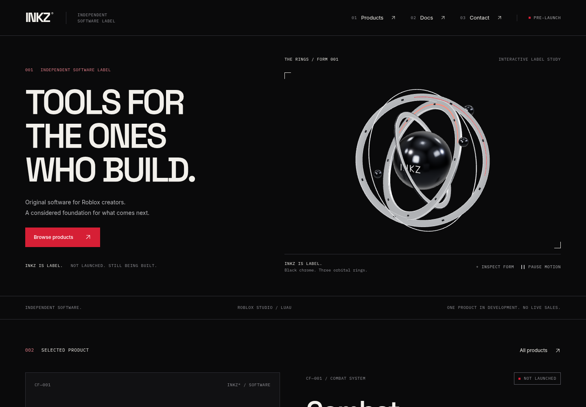
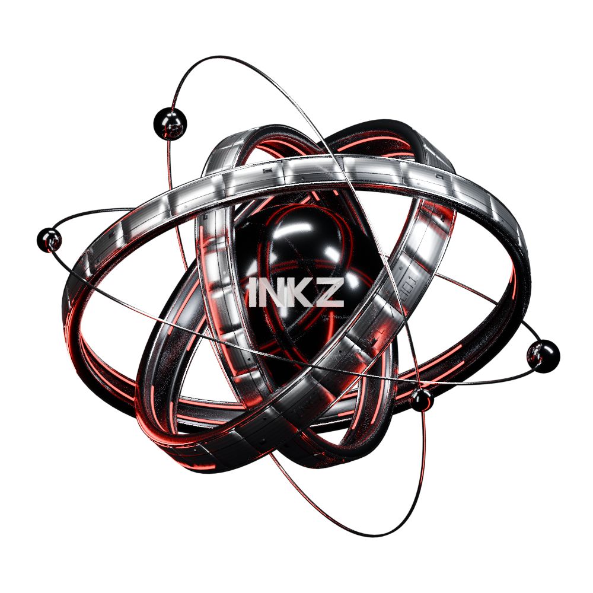
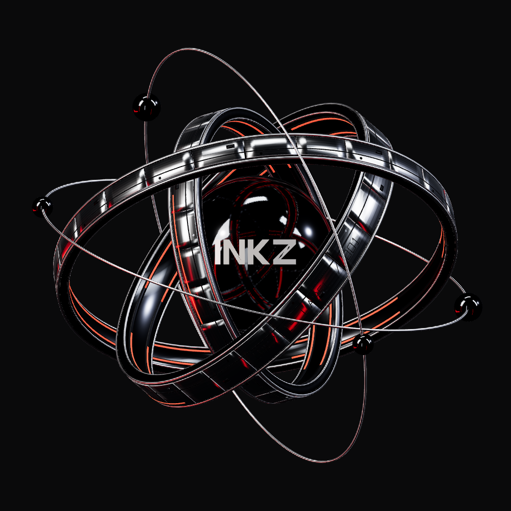

# THE RINGS / FORM 001 — quality review

The approved Hero layout is preserved. This follow-up replaces only the sculpture, studio lighting, motion timing and asset lifecycle. The original V2 model is the **before** view; this directory contains actual renders of the new Blender-authored GLB. No concept-image plane, composited fake 3D or fabricated gameplay is used.

## Compare

| Before: prototype, same desktop viewport | After: actual website WebGL |
| --- | --- |
|  |  |

| Blender Cycles: authored source | Three.js: exported GLB |
| --- | --- |
|  |  |

Both square renders use the same neutral model pose and orthographic camera: Blender `(3.4, -7, 2.5)` → Three `(3.4, 2.5, 7)`, vertical extent **4.9**, 1000 × 1000. The website uses that camera with its existing responsive stage aspect ratio. The primary reference supplied in chat has no camera metadata; its front three-quarter composition and rising diagonal front band are the artistic comparison, not a claim of recovered original camera settings.

The attached primary image was visually inspected. The original `design/references/` directory/named PNG remain absent; the supplied inline image now provides the artistic target. It was never substituted for the model.

| Reference characteristic | Result inspected in these renders |
| --- | --- |
| Substantial intersecting metal hoops | Three curved cylindrical bands, chamfered profiles, different widths and independently centered pivots; no simple torus primitives. |
| Machined silver/chrome surfaces | Curved titanium panels with real seams, polished edge rails, recessed grooves/service pockets and flush hexagonal fasteners. Original PBR machining map exports correctly. |
| Black reflective core with integrated INKZ | Solid surface-following INKZ mesh inlay; core reflects the actual outer rings and red inserts through a baked radiance probe. |
| Controlled red channels and dark negative space | Embedded segmented red inserts, black channel housings and a dark seven-card studio. No bloom. |
| Fine orbital structures and attached satellites | Two fine filaments with four physically attached satellite nodes; no unconnected floating decorative field. |

Differences remain deliberate and visible: this interpretation uses cleaner, regular panel seams and less distressed surface wear; the secondary orbital paths and ring tilts are not an exact reconstruction of the reference. The browser uses image-based lighting and a static core probe, so it has less red light bounce than the Cycles render/reference. The core probe stays at the neutral pose during subtle movement/inspection. No exact-image-match, path-traced realtime result or owner visual approval is claimed.

## Actual interactive views

- [Desktop Hero](./desktop-hero.png) · [artifact](./desktop-artifact.png) · [Inspect](./desktop-inspect.png)
- [Mobile Hero](./mobile-hero.png) · [complete mobile Hero](./mobile-full-hero.png) · [artifact](./mobile-artifact.png) · [Inspect](./mobile-inspect.png)
- [Reduced-motion desktop](./desktop-reduced-motion.png) · [mobile](./mobile-reduced-motion.png): rendered source-model poster, no WebGL transfer.
- [Matching main view](./webgl-matching-main.png) · [opposite quarter](./webgl-quarter-left.png) · [side](./webgl-side.png) · [wireframe](./webgl-wireframe.png)
- [Render data, viewports and browser errors](./render-review.json) · [real Blender MCP inspection](./blender-mcp-inspection.json)

These are **local production-build** screenshots from Chromium using software WebGL, plus the actual Blender source render. They are not deployed-browser screenshots or physical-device performance evidence. The existing V2 [all-route screenshots and route review](../v2/README.md) remain historical evidence for the unchanged layout/pages.

## Budgets and lifecycle

- Actual glTF 2.0: **787,784 bytes, 41,436 triangles, 30 meshes, one embedded 512 × 128 PBR map**. Limits remain <1.5 MB and <100k triangles. Checker uses actual GLTFLoader parsing, CPU image decoding and hoop/PBR checks.
- Base studio **69,929 bytes gzip / 1,572,880 decoded bytes**. Core probe **353,784 bytes gzip / 1,572,880 decoded bytes**. Both use face size 128; close-up review found visible pixelation with the smaller face-size-64 probe, so it was replaced. Neither is generated on the customer's GPU.
- Three rings have subtle independent entrance/inspection axes. The 4.8-second entrance settles; there is no perpetual idle spin. Pointer interaction, Inspect/Reset and Pause/Resume remain accessible. Maximum draw cadence 30 fps desktop / 20 fps coarse pointer, capped DPR, visibility/background suspension and **zero GPU draws at rest**.
- A regression exposed frame-rate-dependent damping under software rendering. Damping now uses elapsed time; exact inspection/reset/neutrality checks are retained, not weakened. Pause/suspension resets the timing origin.
- Abortable lazy requests, genuine poster fallback for all three asset failures, reduced motion/Save-Data, shader preparation before reveal and context-loss behavior remain. A content-hashed static poster import prevents serving the prototype from image cache.
- Unique model resources dispose once. Shared decoded PBR ImageBitmaps close once per unload, verified through two navigation cycles. The studio/probe textures have separate explicit ownership and disposal.

## Verification

- `npm run lint`, `npm run typecheck`, `npm run build`: **passed** on the final application source. The existing local `metadataBase` warning remains because no verified public origin is configured.
- `node scripts/check-rings.mjs`: **passed**, including real GLTFLoader parsing, embedded-image decoding, PBR/UV/depth assertions and both prefiltered texture formats/budgets.
- `npm run test:server`: **45 passed**, zero failures/skips. These are synthetic security tests, not a hosted Stripe transaction.
- `npm run test:e2e -- --workers=2`: **77 passed, 1 intentional skip, zero failures** in 5.0 minutes. Includes all public routes and Sandbox states, Axe WCAG A/AA, responsive widths, keyboard/touch, no-JavaScript content, real GPU GLB/PBR loading, all three asset failures, image-decode failure, context loss, live reduced motion, exact reset/neutrality, idle draw suspension and bitmap teardown.
- Earlier iterations exposed slow-frame damping and one texture-cleanup observation failure (74 passed / 1 failed / 1 skipped in that run). Damping was fixed. The cleanup case passed in isolation; the final test additionally confirms decoding and explicitly awaits route teardown while retaining exact one-close-per-image assertions. The final complete run above supersedes the earlier result; no failed run is counted as a pass.
- [Actual browser motion recording](./motion-review.mp4): entrance, inspection, pause/resume, reset, pointer interaction and viewport suspension. Recorded from the production build, not a concept animation.
- [Capture/performance observations](./render-review.json): actual viewport/model/error data and a measured 300 ms idle interval. These software-WebGL timings are single local observations, not physical-device benchmarks or a new Lighthouse score. The earlier V2 Lighthouse results belong to the historical prototype and are not reused as current-model scores.

Reproduce evidence with the local production server on 3110 and the local viewer on 3112:

```sh
node scripts/capture-rings-quality.mjs
INKZ_REVIEW_OUTPUT="$PWD/docs/visual-review/rings-quality" node scripts/record-v2.mjs
```

Playwright's FFmpeg installation or system FFmpeg is required for the recording. This workspace uses `PLAYWRIGHT_BROWSERS_PATH=/tmp/inkz-playwright` for its installed recorder binary. No Stripe credentials were required. Model/studio generation is documented in [the asset source record](../../../assets/source/README.md).

Remaining manual review: owner visual approval, physical-device profiling, and authenticated Vercel Preview review. The store remains pre-launch; `paymentsEnabled: false`, product data, API endpoints, payment security, navigation, typography and Hero layout are unchanged. No Production deployment or merge is authorized/performed.
